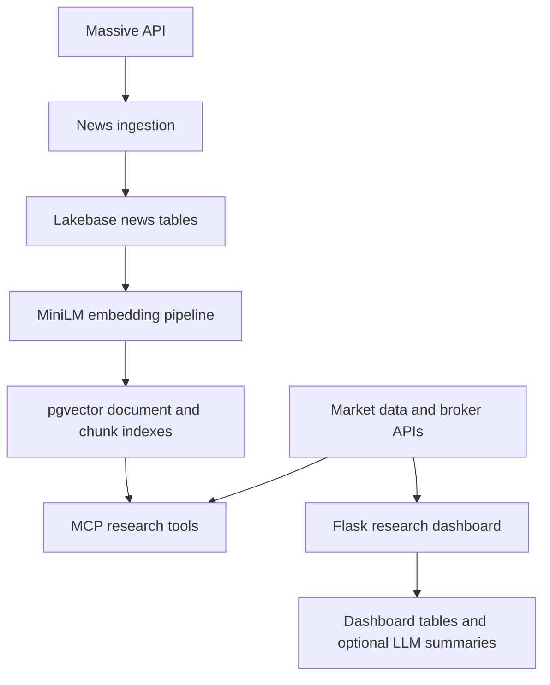

# AI Stock Research Assistant

**Market news ingestion, vector retrieval, and research tools in one Python project.**

A project independently implemented by **Rina** as part of the DataExpert.io bootcamp, exploring how data engineering and AI applications can support stock research. It brings together market data, searchable news, watchlists, and research notes so a user can investigate a company without switching between separate tools.

**Python · Databricks · Lakebase / PostgreSQL · pgvector · sentence-transformers · FastMCP · Flask**

## What the project demonstrates

| Capability | Implementation evidence |
| --- | --- |
| Market data ingestion | [Massive API client](src/ingestion/massive_client.py), [ingestion interface](app/ingestion_app.py), and [notebooks](notebooks/) |
| News embeddings | [Embedding notebook export](src/embeddings/ingest_ticker_news_embeddings.py): article and chunk embeddings, batched encoding, duplicate-skipping inserts |
| Vector retrieval | [MCP server](src/agent/alpaca_mcp_server.py): document and chunk retrieval using pgvector cosine distance |
| Research tools | [MCP server](src/agent/alpaca_mcp_server.py): quotes, performance, fundamentals, comparisons, watchlists, and notes |
| Conversational interface | [Flask application](app/app.py) and [intent handlers](app/agent.py) for research commands |
| Persistent application data | [Dashboard schema and queries](app/db.py), plus [SQL schemas](sql/) for the news/MCP workflow |
| Trading simulation | [Paper broker](src/agent/paper_broker.py) and staged trade / confirmation tools in the MCP server |

The repository contains two related implementations. The Flask dashboard routes messages to Python handlers and optionally uses an LLM for summaries. The separate MCP server exposes tools to an MCP client. The dashboard is not documented here as a fully autonomous agent or as an MCP client.

## Architecture



### Two retrieval paths

| Path | Embeddings and storage | Retrieval |
| --- | --- | --- |
| News pipeline + MCP | Default MiniLM model, 384-dimensional vectors in PostgreSQL pgvector columns | Database cosine-distance queries; HNSW indexes defined in SQL |
| Flask dashboard | Databricks embedding endpoint; vectors serialized into text columns | Cosine similarity calculated in Python |

The dashboard also includes a deterministic hash-vector fallback when its embedding endpoint is unavailable. Those fallback vectors are not a substitute for semantic embeddings, so fallback results should not be used to evaluate semantic retrieval quality.

## Engineering choices visible in the code

- **Document and chunk retrieval:** the news pipeline embeds titles/descriptions and overlapping article-content chunks. Defaults are 800 characters per chunk with 100 characters of overlap.
- **Repeatable inserts:** news and embedding inserts use stable IDs with `ON CONFLICT DO NOTHING` to skip existing records. This handles repeat ingestion; it does not refresh an existing record when its content changes.
- **Model metadata:** embedding tables record the model name and embedding timestamp. Changing models also requires checking vector dimensions and rebuilding compatible embeddings/indexes.
- **SQL-backed retrieval:** the MCP path keeps vectors in PostgreSQL and uses pgvector rather than introducing a separate vector database.
- **Separate entry points:** ingestion, notebook processing, dashboard requests, and MCP tools have different runtime requirements. Choose a workflow before configuring the environment.

## Repository guide

| Location | Purpose |
| --- | --- |
| [src/ingestion/](src/ingestion/) | API client, database connection helper, and secret setup |
| [src/transformations/](src/transformations/) | Transformation application and supporting clients |
| [src/embeddings/](src/embeddings/) | Databricks notebook export for news and chunk embeddings |
| [src/agent/](src/agent/) | FastMCP server, market data adapters, and broker modules |
| [app/](app/) | Flask dashboard, intent handlers, database queries, and deployment configurations |
| [notebooks/](notebooks/) | Databricks workflow notebooks exported as Python |
| [sql/](sql/) | News/vector, watchlist, and research-note schemas |
| [tests/test_watchlist.py](tests/test_watchlist.py) | External-service integration demonstration |
| [docs/](docs/) | Earlier implementation and deployment walkthroughs |

## Setup and runtime requirements

This is a Databricks-oriented project. A clean-machine, end-to-end setup has not been verified in this documentation update.

### 1. Prepare the environment

Use a Databricks workspace, a Lakebase/PostgreSQL database, and credentials for the data services needed by your chosen workflow. The news/MCP workflow requires pgvector. LLM summaries and dashboard embeddings require access to the configured Databricks model endpoints.

```bash
git clone https://github.com/Rina033/ai-stock-research-assistant.git
cd ai-stock-research-assistant
python -m venv .venv
source .venv/bin/activate
pip install -r requirements.txt
```

The root requirements provide the core packages. Notebook and model-serving dependencies must also be available in the selected Databricks runtime; this is not a verified dependency lockfile.

### 2. Configure credentials

Review [.env.example](.env.example), [secret setup](src/ingestion/setup_secrets.py), and the connection helper for the workflow you run.

The source helpers use Databricks secret scopes such as `database/lakebase-url` and `massive/api-key`. Scope/key names can be configured through environment variables. The example API hostname in `.env.example` is a placeholder; use the actual API base URL configured for your service.

Keep credentials outside Git. A local `.env` file alone does not replace Databricks authentication and secret-scope access.

### 3. Prepare the relevant schema

For news/vector retrieval, review and apply [sql/schema.sql](sql/schema.sql). Research-note and visit-tracking tools additionally use [sql/05_setup_research_notes.sql](sql/05_setup_research_notes.sql).

The dashboard defines a separate schema in [app/db.py](app/db.py). These schemas are not interchangeable. Check the queries used by your chosen entry point before applying SQL.

### 4. Select an entry point

| Workflow | Entry point | Runtime note |
| --- | --- | --- |
| News ingestion | [app/ingestion_app.py](app/ingestion_app.py) | Flask application; requires API and database access |
| Embedding generation | [src/embeddings/ingest_ticker_news_embeddings.py](src/embeddings/ingest_ticker_news_embeddings.py) | Import/run as a Databricks notebook; uses `dbutils.widgets` and notebook display functions |
| Research dashboard | [app/app.py](app/app.py) | [app/app.yaml](app/app.yaml) launches `python app.py` from the app source directory |
| MCP tool server | [src/agent/alpaca_mcp_server.py](src/agent/alpaca_mcp_server.py) | Requires its sibling broker modules, database configuration, and an MCP client |

The MCP deployment configuration in [app/mcp_app.yaml](app/mcp_app.yaml) references `alpaca_mcp_server.py`, which lives in `src/agent/`. Assemble the deployment source directory accordingly; deploying `app/` alone will not provide that entry point.

### Example research commands

These illustrate the intended dashboard workflow; successful responses depend on configured services and available data.

- `Add AAPL to my watchlist`
- `Show my watchlist`
- `Compare AAPL and MSFT`
- `Show news for AAPL`
- `What changed since last visit?`

## Validation and current limitations

- **Testing:** [test_watchlist.py](tests/test_watchlist.py) is an integration demonstration that calls external services and writes watchlist data. Its import paths and expected watchlist columns need alignment with the chosen runtime/schema. It is not evidence of a passing automated test suite.
- **Deployment:** this repository contains deployment configurations, but no live demo availability is asserted here.
- **Retrieval quality:** no measured relevance benchmark, latency result, or production-scale throughput is published here.
- **User isolation:** some MCP functions have demo email defaults, while the dashboard supports a default user. Review identity handling before multi-user deployment.
- **Configuration consistency:** the dashboard and MCP paths have different schemas and embedding approaches. Model dimensions, table names, and source packaging require verification.
- **Project ownership:** Rina independently implemented the full project, including data ingestion, transformations, embedding generation, retrieval, MCP tools, the dashboard, database schemas, and deployment configuration.

## Further reading

- [Ingestion walkthrough](docs/day-1-ingestion.md)
- [Embedding walkthrough](docs/day-2-embeddings.md)
- [Dashboard and MCP walkthrough](docs/day-3-dashboard.md)
- [SQL guide](docs/sql-readme.md)

These walkthroughs capture earlier development steps. Cross-check commands and paths against the current repository and the runtime notes above.

## License

See [LICENSE](LICENSE).
